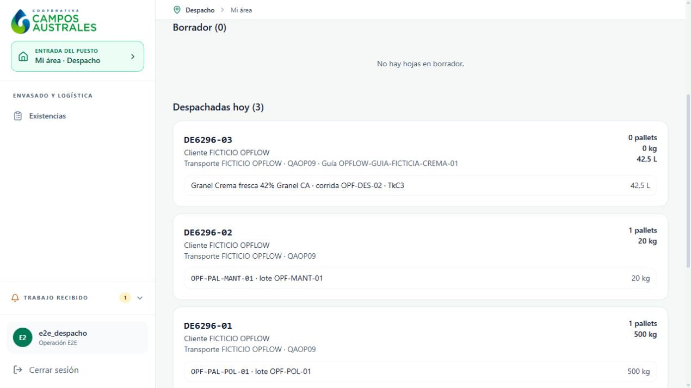
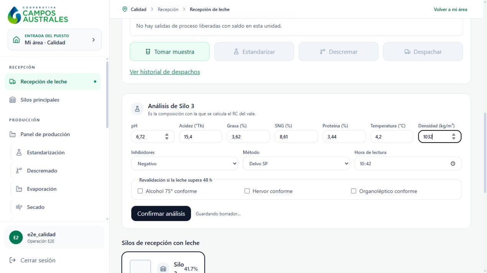

# Pantallas reales — prueba ficticia OPFLOW

Capturas del navegador local. Son datos de simulación, no producción ni prueba de inocuidad. Formularios, decisiones y resultados se distinguen por su descripción. [Informe](../../OP-09_OPERACIONAL_RESULTADOS.md).

| Paso | Evidencia |
| --- | --- |
| 013 | [Descarga confirmada:25000L en Silo3](013-descarga-entera-silo3-25000L.png) |
| 014 | [Formulario de análisis de Silo3](014-calidad-silo3-formulario-relleno.png) |
| 015 | [Silo3: análisis y segundo firmante](015-silo3-analisis-con-dos-firmas.png) |
| 017 | [Plan de descremado10000L](017-descremado-plan-10000L-relleno.png) |
| 019 | [Cierre con precisión realmente capturada0,06%MG](019-descremado-salidas-precision-formulario.png) |
| 020 | [Descremado cerrado, dos destinos](020-descremado-cerrado-dos-destinos.png) |
| 025 | [Calidad selecciona muestra de descremada](025-liberacion-descremada-analisis-elegido.png) |
| 026 | [Calidad selecciona muestra de crema](026-liberacion-crema-analisis-elegido.png) |
| 028 | [Formulario vale15000L](028-vale-15000L-formulario.png) |
| 029 | [Cantidades calculadas de cada origen](029-vale-mezcla-calculada.png) |
| 031 | [Muestra ficticia; advertencia de agitación física pendiente](031-vale-muestra-ficticia-aviso-agitacion.png) |
| 033 | [Vale liberado por Calidad](033-vale-liberado-calidad.png) |
| 036 | [Apertura de polvo6000L](036-apertura-lote-polvo-6000L.png) |
| 038 | [Cierre de evaporación1500L](038-evaporacion-cierre-1500L.png) |
| 040 | [Concentrado con dos firmantes](040-silo5-concentrado-dos-firmas.png) |
| 043 | [Balance de Secado500kg; ticket ficticio](043-secado-balance-500kg-relleno.png) |
| 046 | [Análisis ficticio de polvo](046-calidad-polvo-analisis-relleno.png) |
| 049 | [Envase20sacos×25kg y horas realmente visibles](049-envase-20-sacos-pallet-formulario.png) |
| 051 | [Pallet confirmado, todavía pendiente de Calidad](051-pallet-500kg-confirmado-pendiente-calidad.png) |
| 052 | [PCC1: atestación simulada, no prueba física](052-pcc1-atestacion-ficticia.png) |
| 053 | [Equipo no utilizado: piezasN/A](053-calidad-Scheffers3-no-aplica.png) |
| 057 | [Registro de Envase ficticio](057-checklist-envase-rovema3-ficticio.png) |
| 062 | [Lecitina expresamente no utilizada](062-lecitina-no-usada-simulacion.png) |
| 071 | [Dossier completado sólo como simulación](071-calidad-final-checklist-simulado-completo.png) |
| 074 | [Bodega:500kg en PT-DISP](074-bodega-pallet-500kg-PT-DISP.png) |
| 076 | [Formulario de hoja de carga del polvo](076-despacho-hoja-carga-rellena.png) |
| 080 | [Polvo: despacho ejecutado](080-despacho-DE6296-01-ejecutado.png) |
| 081 | [Mantequilla: formulario36kgcrema](081-mantequilla-formulario-36kg-crema.png) |
| 082 | [Mantequilla31kg+5merma, caso con grasa incompatible](082-mantequilla-balance-ficticio-31kg.png) |
| 083 | [Análisis ficticio de mantequilla](083-calidad-mantequilla-analisis-relleno.png) |
| 084 | [Liberación ficticia con limitación de balance documentada](084-mantequilla-liberacion-ficticia-con-limitacion.png) |
| 085 | [Caja20kg, prorrateo0,04pallet visible](085-mantequilla-envase-caja-20kg-formulario.png) |
| 086 | [Caja confirmada y remanente11kg](086-mantequilla-caja20kg-remanente11kg-confirmado.png) |
| 087 | [Calidad dispone rework11kg](087-rework-mantequilla-11kg-disposicion.png) |
| 093 | [Rework confirmado disponible por Bodega](093-rework-habilitacion-confirmada-11kg.png) |
| 094 | [Caja20kg en PT-DISP](094-caja-mantequilla20kg-en-PT-DISP.png) |
| 095 | [Formulario de despacho de mantequilla](095-despacho-caja20kg-formulario.png) |
| 098 | [Mantequilla: despacho ejecutado](098-despacho-caja20kg-ejecutado.png) |
| 099 | [Formulario salida de leche cruda1000L](099-despacho-cruda1000L-formulario.png) |
| 100 | [Historial confirma salida de leche cruda](100-despacho-cruda1000L-confirmado.png) |
| 101 | [Trazabilidad: faltan lotes de origen; ubicación históricaSilo5](101-trazabilidad-polvo-hacia-atras.png) |
| 102 | [Rework11kg sin ejecución destino](102-rework11kg-sin-ejecucion-destino.png) |
| 103 | [Suero externo sin orden/material de entrada](103-suero-externo-sin-orden-ni-materia-prima.png) |
| 104 | [Nueva crema comercial: plan500L](104-crema-comercial-plan500L.png) |
| 105 | [Crema comercial: cierre42,5L y descremada457,5L](105-crema-comercial-cierre500L.png) |
| 106 | [Formulario análisis TkC3](106-crema-comercial-analisis-TkC3.png) |
| 107 | [Formulario análisis Tk03](107-descremada-Tk03-analisis.png) |
| 108 | [TkC3: segundo firmante](108-crema-TkC3-dos-firmantes.png) |
| 109 | [Tk03: segundo firmante](109-descremada-Tk03-dos-firmantes.png) |
| 110 | [Decisión de Calidad de crema comercial](110-crema-comercial-decision-Calidad.png) |
| 111 | [Formulario de despacho crema42,5L](111-despacho-crema42.5L-formulario.png) |
| 112 | [Confirmación final de crema](112-despacho-crema42.5L-confirmacion.png) |
| 113 | [Crema despachada y tres hojas ejecutadas](113-despacho-crema42.5L-ejecutado.png) |

## Vista de cierre

## Ejemplo de formulario relleno

