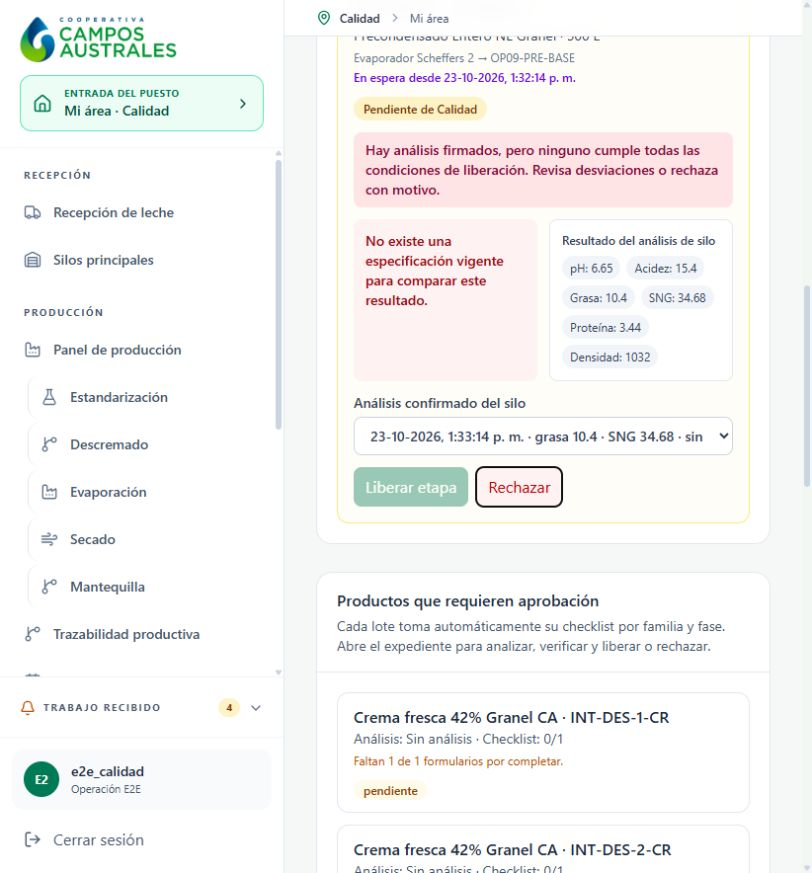

# Precondensado — pantallas de prueba local

[Expediente y traba concreta](../../OP-09_PRECONDENSADO.md). Sólo datos ficticios.500L siguen bloqueados por Calidad, sin despacho.

| Paso | Qué muestra |
| --- | --- |
| 114 | [Vale2000L: borrador antes de completar composición](114-precondensado-vale2000L-formulario.png) |
| 115 | [Mezcla calculada1426,60L entera+573,40L descremada](115-precondensado-mezcla2000L-calculada.png) |
| 116 | [Muestra ficticia con advertencia de0minagitación](116-precondensado-vale-muestra-aviso-agitacion.png) |
| 117 | [VE6296-02 liberado por Calidad](117-precondensado-vale-VE6296-02-liberado.png) |
| 118 | [Análisis viejo invalidado por ingreso nuevo2000L](118-silo5-analisis-anterior-invalidado-por-nuevo-ingreso.png) |
| 119 | [Formulario de análisis de mezcla nueva](119-precondensado-mezcla-silo5-analisis.png) |
| 120 | [Lote y única orden2000L autorizada seleccionados](120-precondensado-lote-OPF-PRE-01-formulario.png) |
| 121b | [Análisis nuevo de mezcla con segundo firmante confirmado](121b-precondensado-mezcla-firma-confirmada.png) |
| 122 | [Destino vacío OP09-PRE-BASE seleccionado](122-precondensado-evaporacion-destino-OP09-PRE-BASE.png) |
| 123 | [Cierre500L,45,08%sólidos y62,50°C ficticios](123-precondensado-cierre500L-formulario.png) |
| 124 | [Corrida cerrada500L pendiente de Calidad](124-precondensado500L-cerrado-pendiente-Calidad.png) |
| 125 | [Formulario de análisis de salida ficticio](125-precondensado500L-analisis-salida-ficticio.png) |
| 126 | [Análisis de salida con dos firmantes](126-precondensado500L-dos-firmantes.png) |
| 127b | [Especificación ausente y botón Liberar etapa bloqueado](127b-precondensado-boton-liberar-bloqueado.png) |
| 128 | [Precondensado no ofrecido para cargar en Despacho](128-precondensado-no-ofrecido-despacho-sin-liberacion.png) |

## Bloqueo observado

